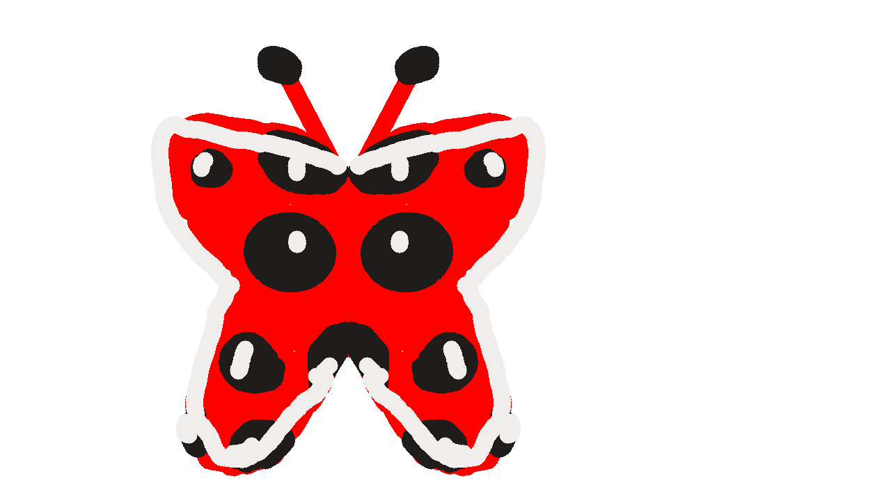

# ✋ Havada Çizim

Kamerayla elini takip eden ve **havada çizim yapmanı** sağlayan bir Python projesi. Fare ya da kalem yok: başparmağınla işaret parmağını birleştirip (tutam) havada hareket ettirdiğinde ekrana çizersin.

![Örnek çizim]

*Simetri modu ile çizilmiş bir kelebek.*

## Özellikler

- 🤏 **Tutam ile çizim:** Parmaklar ayrıyken sadece imleç görünür, birleşince çizer. El kameraya girdiği an çizmeye başlamaz.
- 🌈 **Gökkuşağı renk seçici:** Tek tutamla renk, ton ve parlaklık seçilir, renk karışımları yapılabilir.
- 📏 **Ayarlanabilir kalınlık** ve canlı fırça önizlemesi.
- 🪞 **Simetri modu:** Çizdiğin her şey dikey eksene göre aynalanır (kelebek, mandala, yüz çizmek için).
- 🔷 **Şekil tanıma:** Elle çizdiğin çizgi, daire, elips, üçgen ve dikdörtgeni düzgün hâline çevirir. Kalp, yıldız gibi şekillere dokunmaz.
- 🎯 **Titreme azaltma:** El konumuna "One Euro" filtresi uygulanır, yavaş çizerken yumuşak, hızlı çizerken gecikmesiz çalışır.
- ↩️ Silgi, geri al (20 adım), temizle ve resmi PNG olarak kaydetme.

## Kurulum

Python 3.9 veya üzeri gerekir (Python 3.14 ile denendi). Bilgisayarında ya da dizüstünde bir kamera olmalı. Masaüstü bilgisayarda kamera yoksa telefonunu DroidCam ya da Iriun Webcam ile kamera olarak kullanabilirsin.

```bash
git clone https://github.com/ey7025992-rgb/havada-cizim..git havada-cizim
cd havada-cizim
pip install -r requirements.txt
python havada_cizim.py
```

İlk çalıştırmada MediaPipe el modeli (`hand_landmarker.task`, yaklaşık 8 MB) otomatik indirilir, internet bağlantısı gerekir. Sonraki açılışlarda tekrar inmez.

## Nasıl kullanılır?

| Hareket | Ne yapar |
|---|---|
| Başparmak + işaret parmağı **ayrık** | Sadece imleç görünür, çizmez |
| Başparmak + işaret parmağı **birleşik** (tutam) | Çizer, panelde bir şeye basılıysa seçer ya da sürükler |

Sağdaki panelde:

- **Gökkuşağı çubuğu:** Rengi seçer.
- **Kare:** Seçilen rengin açık, koyu, soluk hâllerini karıştırır.
- **Kalınlık çubuğu:** Fırça kalınlığını ayarlar.
- **SILGI / GERI AL / TEMIZLE / KAYDET:** Butonların üzerine gelip tutam yapman yeterli.
- **SIMETRI:** Ayna modunu açar ve kapatır.
- **SEKIL:** Şekil tanımayı açar ve kapatır.

### Klavye kısayolları

| Tuş | İşlev |
|---|---|
| `q` | Çıkış |
| `s` | Çizimi `cizim_<zaman>.png` olarak kaydet |
| `c` | Tuvali temizle |
| `z` | Geri al |
| `m` | Simetri modunu aç/kapat |
| `t` | Şekil tanımayı aç/kapat |

## Ayarlar

Kodun başındaki `AYARLAR` bölümünden değiştirilebilir:

| Ayar | Anlamı |
|---|---|
| `PINCH_AC`, `PINCH_BIRAK` | Tutam hassasiyeti. `PINCH_AC` büyürse tutam daha kolay algılanır |
| `TITREME_MIN` | Küçültürsen çizgi daha yumuşak, büyütürsen daha hızlı tepki verir |
| `MIN_BOYUT`, `MAX_BOYUT` | Fırça kalınlığı aralığı |
| `W`, `H` | Pencere boyutu |

## Sorun giderme

- **Siyah ekran ya da "Kamera bulunamadı":** Kodda `cv2.VideoCapture(0)` yerine `1` dene.
- **`ModuleNotFoundError: No module named 'mediapipe'`:** Paketler başka bir Python sürümüne kurulmuş olabilir. `python -m pip install -r requirements.txt` komutunu, kodu çalıştırdığın Python ile çalıştır.
- **Tutam algılanmıyor ya da çok kolay algılanıyor:** `PINCH_AC` değerini ayarla.
- **Çizgi titriyor:** Işığı artır, eli kameradan yarım metre kadar uzakta tut, `TITREME_MIN` değerini düşür.

## Kullanılan teknolojiler

- [OpenCV](https://opencv.org/): Kamera görüntüsü, çizim ve arayüz
- [MediaPipe](https://ai.google.dev/edge/mediapipe): El ve parmak ucu takibi
- [NumPy](https://numpy.org/): Tuval ve matematik işlemleri

## Fikirler (yapılacaklar)

- Neon / parıltı fırçası
- Kaydederken çizimi otomatik kırpma
- Türkçe karakter desteği (Pillow ile)
- Meyve Ninja gibi el kontrollü oyunlar
